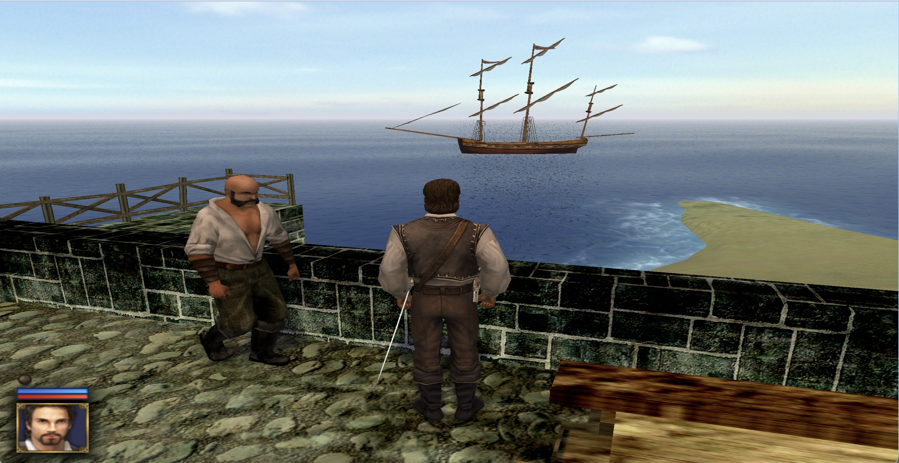

# «Корсары 2» в браузере

[English](README.md) | Русский | [Українська](README.uk.md)



**[Играть в браузере](https://corsairs-2-streaming.web-port.workers.dev/)**

Это тестовый сайт для демонстрации: у него есть ограничения, и он может быть отключён в любой момент.

Сохранения хранятся в браузере отдельно для каждого адреса сайта. Для переноса из локальной версии используйте резервное копирование и импорт на стартовой странице.

Браузерный порт Corsairs 2 (Sea Dogs 2 / Pirates of the Caribbean 1.03, версия 1С). Исполняемые файлы игры статически переводятся из x86 в C и компилируются в WebAssembly. Собственный слой совместимости порта реализует необходимые интерфейсы Windows, Direct3D 8, звука и ввода; браузер выводит графику через WebGPU.

В репозитории есть готовая сборка с игровыми данными, исходники и инструменты порта, а также сгенерированный C-код для его пересборки. Оригинальные исходники игрового движка в проект не входят. Игровые данные и английский языковой слой можно восстановить из сборки для дальнейшей работы без отдельной копии репака.

Первое полное клонирование передаёт около 1,15 ГиБ данных Git; для распакованных файлов потребуется дополнительное место. Фактический объём передачи может отличаться. Git LFS не требуется.

## Быстрый запуск

1. Скачайте или клонируйте репозиторий полностью и перейдите в его корень. Каталог `distribution/` занимает около 1,3 ГиБ.
2. Запустите локальный сервер; нужен Node.js 18.20.8 или новее:

   ```sh
   node play.js
   ```

   На macOS и Linux тот же сервер можно запустить командой:

   ```sh
   ./play
   ```

   Для прямой настройки сервера также можно использовать:

   ```sh
   node scripts/serve_distribution.mjs --port 8007
   ```

3. Откройте `http://localhost:8007/`, выберите язык и одиночную игру. Сервер должен работать, пока открыта игра; для остановки нажмите `Ctrl+C` в терминале.

По умолчанию одиночная игра устанавливает небольшой стартовый набор, а остальные ресурсы скачивает по мере необходимости. Проверенные файлы сохраняются в браузере и используются при следующих запусках; объём хранилища растёт по мере игры. Для загрузки новых ресурсов должен работать локальный сервер. Английский слой устанавливается отдельно. Сохранения игроков в репозитории не содержатся.

Ветка `classic-full-install` сохраняет прежнюю сборку с полной установкой. После получения ветки команда `git worktree add ../corsairs-classic classic-full-install` создаст её отдельную рабочую копию, не перенося незакоммиченные потоковые изменения. В потоковой сборке адрес `http://localhost:8007/?lazy=0` также включает полную установку, которой нужно около 2,4 ГБ в браузере и дополнительное свободное место. Для сетевой игры пока требуется именно этот режим.

Сервер по умолчанию доступен только на этой машине и отдаёт файлы с нужными заголовками, MIME-типами и поддержкой Range. Открытие `distribution/index.html` напрямую через `file://` для игры не подходит.

## Состав готовой сборки

Каталог `distribution/` занимает приблизительно **1,30 ГиБ**:

| Содержимое | Размер |
|---|---:|
| Упакованные данные русской игры, включая манифест | 1 168,47 МиБ |
| Английский языковой слой | 71,54 МиБ |
| WebAssembly-модуль игры | 44,46 МиБ |
| 13 видеороликов MP4 | 47,75 МиБ |
| Страница, JavaScript и служебные файлы | около 0,70 МиБ |

Игровые пакеты содержат 9 826 файлов; после распаковки они занимают около 2,19 ГиБ. Основной объём составляют текстуры, модели, звук и анимация. Английский слой содержит ещё 771 файл и распаковывается примерно до 119 МиБ. В готовую сборку не включены локальные диагностики и пользовательские сохранения.

Brave может показывать ограниченную оценку хранилища, даже когда места больше. Установщик считает такую оценку неизвестной; если реальный лимит будет достигнут, загрузка остановится.

## Требования и управление

Нужен актуальный браузер с работающим WebGPU, включённым аппаратным ускорением, WebAssembly с потоками, локальным файловым хранилищем браузера (OPFS) и Web Locks. Для потоков страница должна быть изолирована (`crossOriginIsolated`); для WebGPU и хранилища нужен защищённый контекст HTTPS или `http://localhost`. Браузер также должен разрешить достаточно дискового пространства. На компьютере проверялась Chromium-среда; работоспособность в конкретном браузере зависит от устройства и драйвера. В приватном окне Vivaldi установка остановилась из-за недостаточной квоты хранилища браузера.

Примеры назначений в поставляемом профиле:

| Действие | Управление |
|---|---|
| Движение вперёд / действие | Правая / левая кнопка мыши |
| Бег, бой, блок | Shift, E, Ctrl |
| Пистолет, уклонение | Q, Z |
| Корабль: поворот и паруса | A/D, W/S |
| Быстрая команда, камера, время | Пробел, Tab, R |
| Пропуск стычки, меню | B, Enter / Esc / F1 / F2 |

Назначения можно посмотреть и изменить в настройках игры. На сенсорном устройстве в одиночной игре появляется панель с вкладками «Берег», «Море и карта», «Меню» и «Ещё»; её трекпад управляет камерой и курсором. Параметр `?touch=1` принудительно включает панель для проверки, `?touch=0` отключает. Подробнее — [сенсорное управление](docs/touch-controls.md).

При новой установке эффекты выставлены на 10%, диалоги — на 90%. При обновлении существующие настройки звука сохраняются; при желании их можно изменить в настройках игры.

По умолчанию игра заполняет область браузера, растягивая исходное изображение 4:3 по горизонтали. Движение мыши показывает кнопку **4:3** в правом нижнем углу: она возвращает исходные пропорции без искажения (на широком экране появятся полосы по бокам). Повторное нажатие возвращает заполнение; выбор сохраняется в браузере. На сенсорном устройстве игровая область остаётся в пропорции 4:3.

Для полноэкранного режима используйте **Alt+Enter** (Option+Enter на Mac) или кнопку в углу. При активном Keyboard Lock одиночный Esc передаётся игре, а два нажатия в пределах 600 мс выводят из полноэкранного режима. Выйти также можно удержанием Esc или через Alt+Enter. Если Keyboard Lock недоступен или отклонён, полноэкранным Esc управляет браузер. Щёлкните по игровой сцене, чтобы захватить указатель и свободно вращать камеру; в меню указатель освобождается. Свободный указатель управляет выбором в меню, а на экранах загрузки виден системный курсор ожидания.

В полноэкранном режиме игры меню также открывается и закрывается клавишей **~ / Ё**. Нажимайте её без Shift. Обычно она находится слева от 1. Если браузер перехватывает Esc, рядом с правым нижним углом появляется кнопка **Esc**.

В Vivaldi на macOS нажмите **Control+Command+F**, чтобы развернуть окно самого браузера на весь экран или выйти из этого режима. В нём **Esc** открывает и закрывает меню игры. Кнопка полного экрана в игре и **Alt+Enter** включают полноэкранный режим веб-страницы.

## Сохранения

Сохранения находятся в хранилище браузера и привязаны к конкретному адресу сайта, включая порт. Перед сменой адреса, очисткой данных сайта или сменой браузера сделайте резервную копию: на стартовом экране выберите **«Скачать сохранения»**, а для переноса — **«Восстановить сохранения»**. Закройте другие вкладки с запущенной игрой перед экспортом или восстановлением. При конфликте имён страница предложит выбрать действие. Очистка данных сайта удаляет локальные сохранения.

В игре сохранение и загрузка доступны через игровое меню; F1 открывает меню в поставляемом профиле. Резервный ZIP храните вне браузера.

Потоковая и полная установка используют отдельные хранилища сохранений. На том же адресе выберите на стартовом экране потоковой версии **«Скопировать сохранения обычной версии»**: при конфликте имён появится выбор, исходные слоты останутся на месте. Можно также перенести ранее скачанный ZIP. Во время морского боя сохранение отключено правилами игры.

## Разработка из клона

Подробные шаги, зависимости и примеры сборки — в [инструкции по настройке из клона](docs/BUILD_FROM_CLONE.md). Все команды ниже выполняются из корня репозитория.

Распакуйте игровые данные и английский слой для разработки:

```sh
node korsary2-next/tools/restore_dist.mjs \
  --dist distribution --game-out korsary2-work/game \
  --overlay-out korsary2-work/english-overlay
```

Инструмент проверяет хеши, сохраняет уже существующие совпадающие файлы и отказывается перезаписывать отличающиеся. Если у вас есть собственные изменения, можно указать новые выходные каталоги и перенести их отдельно. `korsary2-next/game` — ссылка на `korsary2-work/game`.

Для пересборки WebAssembly нужны Emscripten 6.0.13 и закреплённый пакет Dawn `emdawnwebgpu`; настройка SDK и дополнительных зависимостей описана в инструкции. После установки инструментов и восстановления данных:

```sh
sh korsary2-next/recomp/build_web_local.sh
sh korsary2-next/recomp/experimental/lazy-loading/build.sh \
  korsary2-next/recomp/build_web/streaming
```

Первый скрипт собирает общие объекты браузерной и Node-версий, второй создаёт потоковую браузерную сборку в новом каталоге. Для повторной сборки выберите другой новый каталог и передайте его упаковщику, как описано в инструкции. Сборка требует дополнительных гигабайтов свободного места.

## Проверки

Полная проверка готового дистрибутива читает все игровые файлы и сверяет их SHA-256:

```sh
node korsary2-next/recomp/tests/verify_dist.mjs --dist distribution \
  --full-hash --require-overlay --no-freshness --no-videos-web
```

Примеры быстрых регрессионных проверок восстановления данных и сенсорного ввода:

```sh
node --test korsary2-next/recomp/tests/test_restore_dist.mjs
node --test tests/test_git_game_bytes.mjs
node korsary2-next/recomp/tests/test_touch_controls.mjs
node korsary2-next/recomp/tests/test_missing_resource_preflight.mjs
```

Для Node-тестов нужен установленный Node.js. Тесты сборки и игрового процесса не заменяют запуск в браузере после собственных изменений.

## Структура

| Путь | Содержимое |
|---|---|
| `distribution/` | Готовая сборка, упакованные игровые данные, английский слой и видео |
| `scripts/serve_distribution.mjs` | Локальная раздача готовой сборки |
| `korsary2-next/recomp/translator/` | Транслятор машинного кода x86 в C |
| `korsary2-next/recomp/runtime/`, `host/` | Исполняющая среда и реализации системных и графических интерфейсов |
| `korsary2-next/recomp/out_all/` | Сгенерированный C-код для сборки |
| `korsary2-next/recomp/web/` | Страница, загрузка данных, сохранения, локальный сервер и упаковщик |
| `korsary2-next/recomp/tests/` | Тесты компонентов порта и дистрибутива |
| `korsary2-next/tools/` | Восстановление и подготовка данных, конфигурация и инструменты сборки |
| `korsary2-next/content-patches/`, `english-layer/` | Игровые исправления и данные подготовки английского слоя |
| `docs/` | Инструкции и отчёты |

Рабочая копия `korsary2-work/game/`, локальный SDK, кэши сборки, браузерные профили и сохранения создаются отдельно. Не добавляйте пользовательские сохранения и локальные профили в репозиторий.

## Размещение и состояние проверки

Для публикации разместите содержимое `distribution/` на статическом HTTPS-хостинге с поддержкой корректных MIME-типов, Range и заголовков COOP/COEP/CORP. Файл `_headers` содержит правила для совместимых платформ; на другом хостинге настройки необходимо задать отдельно. Перед открытием сайта проверьте реальные HTTP-ответы, `crossOriginIsolated`, установку игры и сохранение/загрузку. Подробности — в [руководстве по размещению](docs/hosting.md).

Потоковая сборка прошла короткие проверки игры, сохранений и восстановления после сбоев; сенсорная панель проверялась в браузерной эмуляции телефона. Настоящие iPhone и Safari пока не проверены. Длительное прохождение и прослушивание звука в согласованный объём работ не входили. Публичная версия размещена в Cloudflare Workers Static Assets; вариант с R2 проверен локально. Подробности и ограничения — в [отчёте о готовности](docs/PUBLICATION_READINESS_2026-11-15_RELEASE.md).
