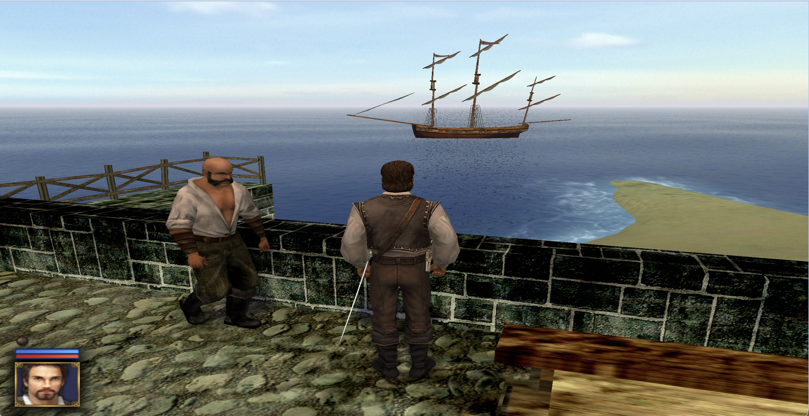

# «Корсари 2» у браузері

[English](README.md) | [Русский](README.ru.md) | Українська



**[Грати в браузері](https://corsairs-2-streaming.web-port.workers.dev/)**

Збереження зберігаються в браузері окремо для кожної адреси сайту. Для перенесення з локальної версії скористайтеся резервним копіюванням та імпортом на стартовій сторінці.

Браузерний порт Corsairs 2 (Sea Dogs 2 / Pirates of the Caribbean 1.03, версія 1С). Виконувані файли гри статично транслюються з x86 у C та компілюються у WebAssembly. Власний шар сумісності порту реалізує необхідні інтерфейси Windows, Direct3D 8, звуку та введення; браузер виводить графіку через WebGPU.

У репозиторії є готова збірка з ігровими даними, вихідний код та інструменти порту, а також згенерований C-код для його повторного збирання. Оригінальний вихідний код ігрового рушія до проєкту не входить. Ігрові дані й англійський мовний шар можна відновити зі збірки для подальшої розробки без окремої копії репака.

Перше повне клонування передає близько 1,15 ГіБ даних Git; для розпакованих файлів знадобиться додаткове місце. Фактичний обсяг передачі може відрізнятися. Git LFS не потрібен.

## Швидкий запуск

1. Завантажте або клонуйте весь репозиторій і перейдіть до його кореня. Каталог `distribution/` займає приблизно 1,3 ГіБ.
2. Запустіть локальний сервер; потрібен Node.js 18.20.8 або новішої версії:

   ```sh
   node play.js
   ```

   На macOS і Linux той самий сервер можна запустити командою:

   ```sh
   ./play
   ```

   Для безпосереднього налаштування сервера також можна використати:

   ```sh
   node scripts/serve_distribution.mjs --port 8007
   ```

3. Відкрийте `http://localhost:8007/`, виберіть мову й одиночну гру. Сервер має працювати, поки гра відкрита; щоб зупинити його, натисніть `Ctrl+C` у терміналі.

Типово одиночна гра встановлює невеликий початковий набір, а решту ресурсів завантажує за потреби. Перевірені файли залишаються у браузері для наступних запусків; використання сховища зростає під час гри. Для завантаження нових ресурсів локальний сервер має працювати. Англійський шар установлюється окремо. Збереження гравців до репозиторію не входять.

Гілка `classic-full-install` зберігає попередню збірку з повним установленням. Після отримання гілки команда `git worktree add ../corsairs-classic classic-full-install` створить її окрему робочу копію, не переносячи незакомічені потокові зміни. У потоковій збірці адреса `http://localhost:8007/?lazy=0` також вмикає повне встановлення, для якого потрібно близько 2,4 ГБ у браузері та додаткове вільне місце. Мережева гра поки потребує саме цього режиму.

За замовчуванням сервер доступний лише на цьому комп’ютері й віддає файли з потрібними заголовками, MIME-типами та підтримкою Range. Відкриття `distribution/index.html` безпосередньо через `file://` для гри не підходить.

## Склад готової збірки

Каталог `distribution/` займає приблизно **1,30 ГіБ**:

| Вміст | Розмір |
|---|---:|
| Упаковані дані російської гри, включно з маніфестом | 1 168,47 МіБ |
| Англійський мовний шар | 71,54 МіБ |
| WebAssembly-модуль гри | 44,46 МіБ |
| 13 відеороликів MP4 | 47,75 МіБ |
| Сторінка, JavaScript і службові файли | приблизно 0,70 МіБ |

Ігрові пакети містять 9 826 файлів; після розпакування вони займають приблизно 2,19 ГіБ. Основний обсяг становлять текстури, моделі, звук і анімація. Англійський шар містить ще 771 файл і розпаковується приблизно до 119 МіБ. До готової збірки не входять локальні діагностики та збереження користувачів.

Brave може показувати обмежену оцінку сховища, навіть коли місця більше. Інсталятор вважає таку оцінку невідомою; якщо фактичного ліміту буде досягнуто, завантаження зупиниться.

## Вимоги та керування

Потрібен актуальний браузер із робочим WebGPU, увімкненим апаратним прискоренням, WebAssembly з потоками, локальним файловим сховищем браузера (OPFS) та Web Locks. Для потоків сторінка має бути ізольованою (`crossOriginIsolated`); для WebGPU та сховища потрібен захищений контекст HTTPS або `http://localhost`. Браузер також має надати достатньо місця у своєму сховищі. На комп’ютері перевірялося середовище Chromium; робота в конкретному браузері залежить від пристрою та драйвера. У приватному вікні Vivaldi встановлення зупинилося через недостатню квоту сховища браузера.

Приклади призначень клавіш у комплектному профілі:

| Дія | Керування |
|---|---|
| Рух уперед / дія | Права / ліва кнопка миші |
| Біг, бій, блок | Shift, E, Ctrl |
| Пістолет, ухилення | Q, Z |
| Корабель: поворот і вітрила | A/D, W/S |
| Швидка команда, камера, час | Пробіл, Tab, R |
| Пропуск сутички, меню | B, Enter / Esc / F1 / F2 |

Призначення можна переглянути й змінити в налаштуваннях гри. На сенсорному пристрої в одиночній грі з’являється панель із вкладками «Берег», «Море и карта», «Меню» та «Ещё» (у російському інтерфейсі); її трекпад керує камерою та курсором. Параметр `?touch=1` примусово вмикає панель для перевірки, `?touch=0` вимикає. Докладніше — [сенсорне керування](docs/touch-controls.md).

Після нового встановлення ефекти встановлено на 10%, діалоги — на 90%. Під час оновлення наявні налаштування звуку зберігаються; за потреби їх можна змінити в грі.

Типово гра заповнює область браузера, розтягуючи початкове зображення 4:3 по горизонталі. Рух миші показує кнопку **4:3** у правому нижньому куті: вона повертає початкові пропорції без спотворення (на широкому екрані з’являться смуги з боків). Повторне натискання повертає заповнення; вибір зберігається в браузері. На сенсорному пристрої ігрова область залишається у пропорції 4:3.

Для повноекранного режиму використовуйте **Alt+Enter** (Option+Enter на Mac) або кнопку в куті. Коли Keyboard Lock активний, одне натискання Esc передається грі, а два натискання в межах 600 мс виводять із повноекранного режиму. Вийти також можна, утримуючи Esc або натиснувши Alt+Enter. Якщо Keyboard Lock недоступний або відхилений, повноекранною клавішею Esc керує браузер. Коли вказівник вільний, курсор меню слідує за ним, а на екранах завантаження видно системний курсор очікування. Камера використовує відносний рух. У віконному режимі вона перестає отримувати рух за межами гри. У повноекранному режимі клацання може захопити вказівник.

У повноекранному режимі гри меню також відкривається й закривається клавішею **~ / Ё**. Натискайте її без Shift. Зазвичай ця клавіша розташована ліворуч від 1. Якщо браузер перехоплює Esc, біля правого нижнього кута з’являється кнопка **Esc**.

У Vivaldi на macOS натисніть **Control+Command+F**, щоб розгорнути вікно браузера на весь екран або вийти з цього режиму. У ньому **Esc** відкриває та закриває меню гри. Кнопка повного екрана в грі й **Alt+Enter** вмикають повноекранний режим вебсторінки.

## Збереження

Збереження містяться у сховищі браузера та прив’язані до конкретної адреси сайту, включно з портом. Перед зміною адреси чи браузера або очищенням даних сайту зробіть резервну копію: на стартовому екрані виберіть **«Скачать сохранения»**, а для перенесення — **«Восстановить сохранения»**. Перед експортом або відновленням закрийте інші вкладки із запущеною грою. У разі збігу імен сторінка запропонує вибрати дію. Очищення даних сайту видаляє локальні збереження.

У грі збереження та завантаження доступні через ігрове меню; F1 відкриває меню в комплектному профілі. Зберігайте резервний ZIP поза браузером.

Потокове й повне встановлення використовують окремі сховища збережень. На тій самій адресі виберіть на стартовому екрані потокової версії **«Скопировать сохранения обычной версии»**: у разі збігу імен з’явиться вибір, початкові слоти залишаться на місці. Також можна перенести раніше завантажений ZIP. Під час морського бою збереження вимкнено правилами гри.

## Розробка з клону

Докладні кроки, залежності та приклади збирання — в [інструкції з налаштування з клону](docs/BUILD_FROM_CLONE.md). Усі наведені нижче команди виконуються з кореня репозиторію.

Розпакуйте ігрові дані й англійський шар для розробки:

```sh
node korsary2-next/tools/restore_dist.mjs \
  --dist distribution --game-out korsary2-work/game \
  --overlay-out korsary2-work/english-overlay
```

Інструмент перевіряє хеші, зберігає наявні однакові файли та відмовляється перезаписувати файли з іншим вмістом. Якщо у вас є власні зміни, можна вказати нові вихідні каталоги й перенести їх окремо. `korsary2-next/game` — символічне посилання на `korsary2-work/game`.

Для повторного збирання WebAssembly потрібні Emscripten 6.0.13 та зафіксований пакет Dawn `emdawnwebgpu`; налаштування SDK і додаткових залежностей описане в інструкції. Після встановлення інструментів і відновлення даних:

```sh
sh korsary2-next/recomp/build_web_local.sh
sh korsary2-next/recomp/experimental/lazy-loading/build.sh \
  korsary2-next/recomp/build_web/streaming
```

Перший скрипт збирає спільні об’єкти браузерної та Node-версій, другий створює потокову браузерну збірку в новому каталозі. Для повторного збирання виберіть інший новий каталог і передайте його пакувальнику, як описано в інструкції. Збирання потребує кількох додаткових гігабайтів вільного місця.

## Перевірки

Повна перевірка готового дистрибутива читає всі ігрові файли та звіряє їхні SHA-256:

```sh
node korsary2-next/recomp/tests/verify_dist.mjs --dist distribution \
  --full-hash --require-overlay --no-freshness --no-videos-web
```

Приклади швидких регресійних перевірок відновлення даних і сенсорного введення:

```sh
node --test korsary2-next/recomp/tests/test_restore_dist.mjs
node --test tests/test_git_game_bytes.mjs
node korsary2-next/recomp/tests/test_touch_controls.mjs
node korsary2-next/recomp/tests/test_missing_resource_preflight.mjs
```

Для Node-тестів потрібен встановлений Node.js. Тести збирання та ігрового процесу не замінюють запуск у браузері після власних змін.

## Структура

| Шлях | Вміст |
|---|---|
| `distribution/` | Готова збірка, упаковані ігрові дані, англійський шар і відео |
| `scripts/serve_distribution.mjs` | Локальна роздача готової збірки |
| `korsary2-next/recomp/translator/` | Транслятор машинного коду x86 у C |
| `korsary2-next/recomp/runtime/`, `host/` | Виконавче середовище та реалізації системних і графічних інтерфейсів |
| `korsary2-next/recomp/out_all/` | Згенерований C-код для збирання |
| `korsary2-next/recomp/web/` | Сторінка, завантаження даних, збереження, локальний сервер та пакувальник |
| `korsary2-next/recomp/tests/` | Тести компонентів порту й дистрибутива |
| `korsary2-next/tools/` | Відновлення та підготовка даних, конфігурація та інструменти збирання |
| `korsary2-next/content-patches/`, `english-layer/` | Ігрові виправлення та дані підготовки англійського шару |
| `docs/` | Інструкції та звіти |

Робоча копія `korsary2-work/game/`, локальний SDK, кеші збирання, профілі браузерів та збереження створюються окремо. Не додавайте збереження користувачів і локальні профілі до репозиторію.

## Розміщення та стан перевірки

Для публікації розмістіть вміст `distribution/` на статичному HTTPS-хостингу з підтримкою правильних MIME-типів, Range та заголовків COOP/COEP/CORP. Файл `_headers` містить правила для сумісних платформ; на іншому хостингу налаштування потрібно задати окремо. Перед відкриттям сайту перевірте фактичні HTTP-відповіді, `crossOriginIsolated`, встановлення гри та збереження/завантаження. Докладніше — у [посібнику з розміщення](docs/hosting.md).

Потокова збірка пройшла короткі перевірки гри, збережень і відновлення після збоїв; сенсорну панель перевіряли в браузері в режимі емуляції телефона. Справжні iPhone та Safari ще не перевірено. Тривале проходження та прослуховування звуку не входили до погодженого обсягу робіт. Публічну версію розміщено у Cloudflare Workers Static Assets; варіант із R2 перевірено локально. Подробиці й обмеження наведено у [звіті про готовність](docs/PUBLICATION_READINESS_2026-11-15_RELEASE.md).
