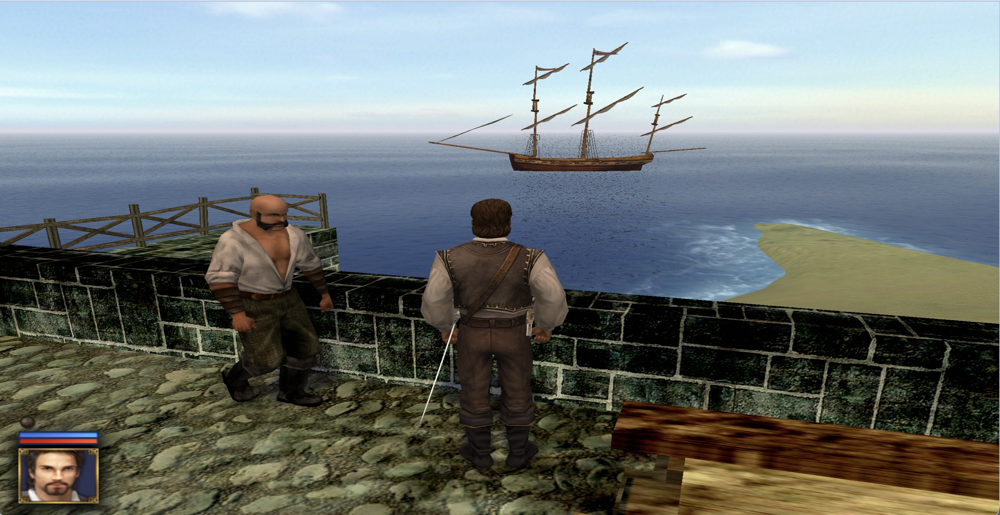

# Recompiler development tools

Install the pinned Node.js dependencies before translating code or running the
recompiler tests:

```sh
npm ci --prefix recomp/translator
npm --prefix recomp/translator test
```

Run these commands from the `korsary2-next` directory. Capstone.js is used by
the translator. The differential and trace tests additionally use Unicorn.js
and Koffi (installed as development dependencies); Koffi loads the compiled
native `libportrecomp.dylib` or `libporttrace.dylib`. Building and running
those native libraries requires the toolchain supported by `recomp/build.sh`.
The synthetic differential test compiles a small native library with Clang.
The `korsary2-work` scripts reuse this implementation and its dependencies.

The differential tester limits each Unicorn execution to two million x86
instructions. Unicorn.js's WebAssembly build cannot use Unicorn's built-in
wall-clock timeout: a nonzero timeout attempts to create a QEMU thread and
aborts. Use an external process-level timeout if a strict wall-clock bound is
needed. The instruction limit and wall-clock timeout are different safeguards.

Examples from `korsary2-next`:

```sh
# Run eight shards against the current native build.
recomp/tests/run_difftest.sh 8

# Compare instruction traces after building a tracing library.
TRACE=1 recomp/build.sh
node recomp/tests/trace_compare.mjs 0x004011f0
```


